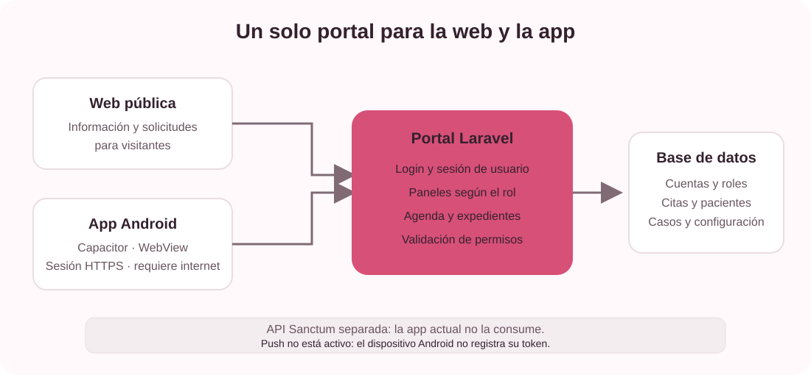
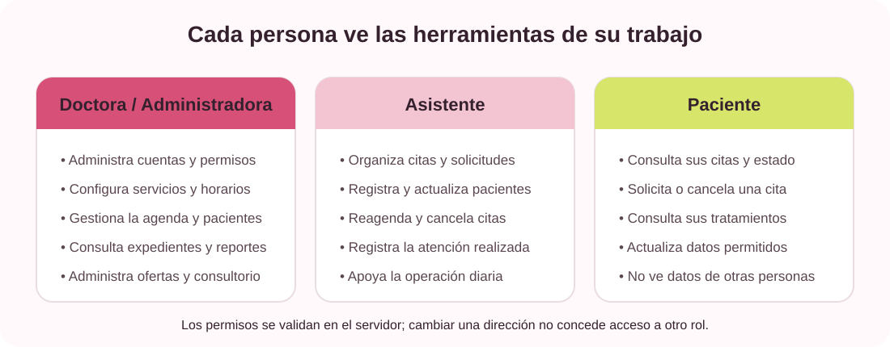
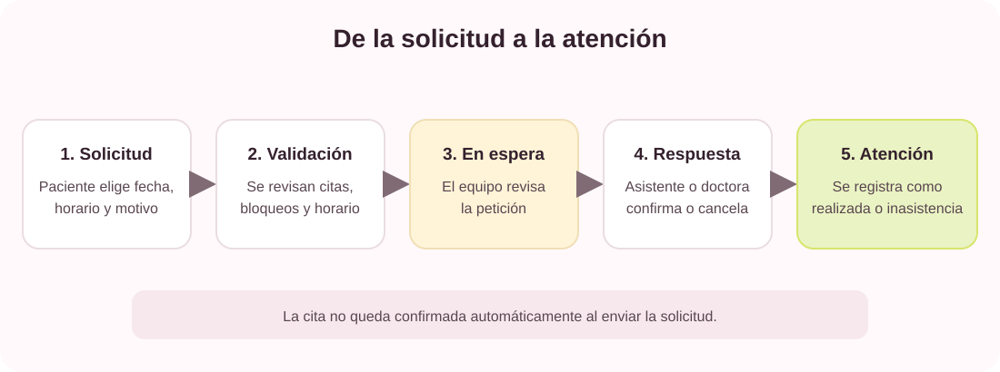

# Dentissa: presentación para la doctora

## ¿Qué es Dentissa?

Dentissa reúne en un solo sistema la información del consultorio, la agenda, los pacientes y el seguimiento de tratamientos. Se puede consultar desde la web pública o desde la app Android, con accesos distintos según la tarea de cada persona.

La app no es otra página pública ni una copia independiente de la base de datos. Abre el portal seguro de Dentissa y muestra únicamente el acceso y el panel autorizado por el rol. Se necesita internet.

## ¿Quién usa cada parte?

| Perfil | Para qué usa el sistema |
| --- | --- |
| Doctora / administradora | Administra usuarios, servicios, horarios, contenido y operación clínica. Consulta agenda, pacientes, expedientes y reportes conforme a los permisos configurados. |
| Asistente | Apoya la operación: revisa solicitudes, organiza citas y pacientes y registra el resultado de la atención en las funciones permitidas. |
| Paciente | Consulta su propia información, citas y tratamientos; puede solicitar o cancelar citas y actualizar los datos permitidos. |

El paciente no puede consultar expedientes de otras personas. La aplicación y la web aplican los permisos desde el servidor; cambiar una dirección no debe conceder acceso a otro panel.

## ¿Cómo se organiza una cita?

1. El paciente elige una fecha y un horario o contacta al consultorio.
2. Dentissa valida el horario disponible tomando en cuenta citas existentes, solicitudes pendientes y bloqueos registrados.
3. La solicitud queda pendiente de revisión; enviarla no significa que ya esté confirmada.
4. La doctora o la asistente revisa la petición y la confirma o cancela.
5. Después de la consulta se registra la atención realizada o la inasistencia.

Los estados de las citas incluyen **en espera**, **confirmada**, **realizada**, **cancelada** y **no se presentó**.

## ¿Qué aporta la app Android?

- Acceso a los paneles de paciente, asistente y administradora con la misma cuenta del sistema.
- Un icono propio de Dentissa en la pantalla del teléfono.
- Acceso desde el teléfono a las vistas web autorizadas por cada rol.
- Recuperación de acceso mediante contacto con la doctora por WhatsApp, si el consultorio configuró su número.

La app requiere internet y no almacena expedientes localmente. En esta versión, las notificaciones push todavía no están activas porque el dispositivo no se registra para recibirlas.

## ¿Qué se debe comprobar antes de entregarla?

- Que la APK actualizada esté instalada en los teléfonos.
- Que cada cuenta abra el panel correcto y que los límites de acceso por rol funcionen.
- Que la agenda, las solicitudes y el contacto por WhatsApp funcionen desde el dispositivo.
- Que el consultorio tenga una dirección HTTPS pública y el WhatsApp correcto configurado.
- Que el equipo sepa que las notificaciones push no están disponibles en esta versión.

## Mensaje breve para presentar

> “Dentissa ayuda a organizar las citas y la información de la clínica. La doctora y la asistente trabajan desde sus paneles con permisos diferentes, y cada paciente consulta solo sus propios datos. La app permite acceder a esos mismos paneles desde Android; para usarla se necesita internet. Las solicitudes de cita se revisan antes de confirmarse.”
